# I-Qbot:01 – De Agostini disc archive (Dutch edition)

Disc images and case photos of the 4 CD-ROMs and the DVD from **I-Qbot:01 – Creëer je eigen intelligente robot**, the build-your-own-robot magazine series published by De Agostini (Netherlands) in 2007–2008.

The ISO files are too big to store in git. You can download them from the **[Releases page](https://github.com/Tropdilee/iqbot-01-deagostini-discs/releases/latest)**.

For a detailed map of what is on each CD, see **[DISC-MAP.md](DISC-MAP.md)**. It covers the hardware, the Linux system image, the microcontroller firmware, the protocols and the flashing procedure.

## Discs

| Disc | File | Volume label | Size | Contents (from the cover) |
|---|---|---|---|---|
| CD-ROM 1 (2007) | `I-QBot_CD-1.iso` | `I_QBOT` | 365 MB | Practical manual, Bluetooth introduction, user instructions: tutorial, simulator, software, assembly videos, manuals and datasheets |
| CD-ROM 2 (2007) | `I-QBot_CD-2.iso` | `I_QBOT_02` | 421 MB | Visual C-like Editor, programming examples, Brain & Vision operating system |
| CD-ROM 3 (2008) | `I-QBot_CD-3.iso` | `I_QBOT_CD3` | 412 MB | Software updates, Java library, C-like manual |
| CD-ROM 4 (2008) | `I-QBot_CD-4.iso` | `IQBOTCDROM4` | 377 MB | New Brain & Vision firmware, software update, Java documentation |
| DVD-Video (2007) | `I-QBot_DVD.iso` | `DEA_IQBOT01_DVD` | 4.03 GB | "Robot in actie!", about 50 minutes: I-Qbot, In het laboratorium, Geschiedenis van een project, De wereld van de robotica |

### Downloading the DVD

GitHub allows at most 2 GB per download file, so the DVD image is split into two parts: `I-QBot_DVD.iso.001` and `I-QBot_DVD.iso.002`. Download both and join them:

**Windows (Command Prompt)**

```bat
copy /b I-QBot_DVD.iso.001 + I-QBot_DVD.iso.002 I-QBot_DVD.iso
```

Or open `I-QBot_DVD.iso.001` with [7-Zip](https://www.7-zip.org/) and choose *Combine files*.

**Linux / macOS**

```bash
cat I-QBot_DVD.iso.001 I-QBot_DVD.iso.002 > I-QBot_DVD.iso
```

### Checking your download

Compare your files with [`SHA256SUMS.txt`](SHA256SUMS.txt):

```bash
sha256sum -c SHA256SUMS.txt --ignore-missing
```

On Windows: `certutil -hashfile I-QBot_DVD.iso SHA256`

## System requirements (CD-ROMs)

| | Minimum | Recommended |
|---|---|---|
| OS | Windows 98 SE (with Internet Explorer 5.0.1), ME, 2000 SP2 or XP Home | |
| CPU | Intel Pentium III 700 MHz or AMD Athlon 1000 | Intel Pentium 4 2.4 GHz or AMD Athlon 2800+ |
| RAM | 128 MB | 256 MB |
| Other | 24x CD-ROM drive, SB16-compatible sound card, 800×600 display with 16-bit colour, Acrobat Reader 5.0.5, Java 2 Runtime Environment 1.4.2_10 | |

**Installing:** insert the CD and wait for autorun. If autorun does not start, open the CD in Explorer and run `i-qbot.exe`. The first time it runs, it installs a component for the Bluetooth connection.

## Photos

### DVD

| Cover | Inside |
|---|---|
| 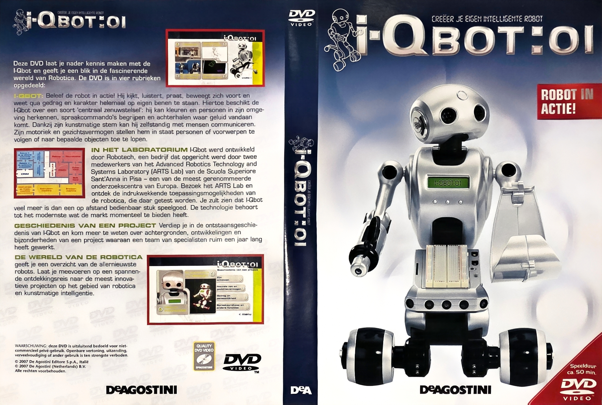 | 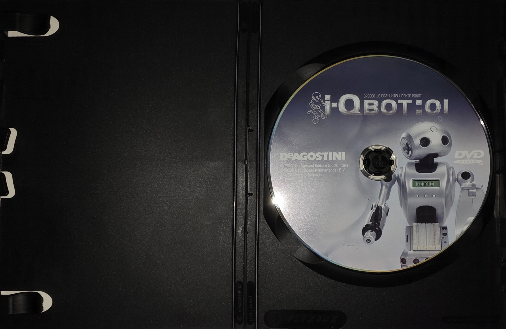 |

### CD-ROM 1

| Front and back | Inside case | Flyer |
|---|---|---|
| 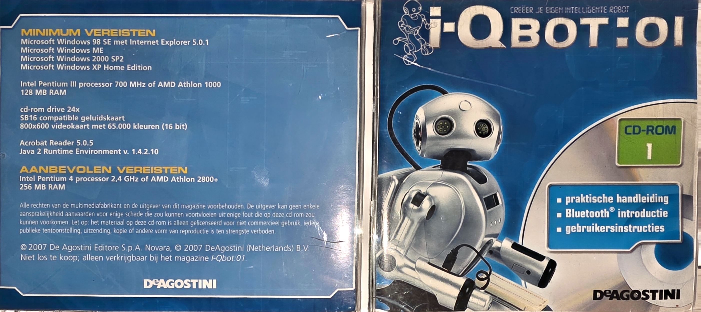 | 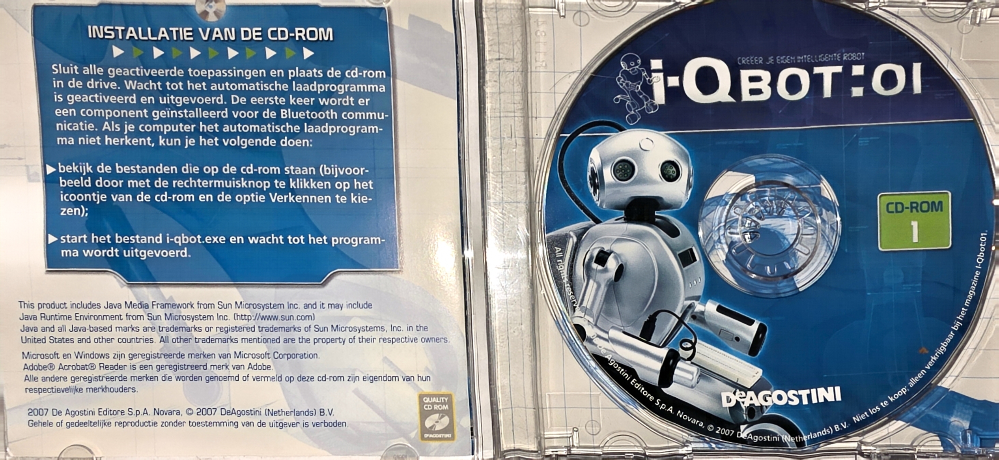 | 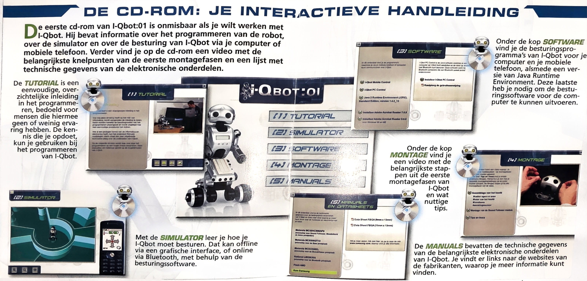 |

### CD-ROM 2

| Front and back | Inside case | Flyer |
|---|---|---|
| 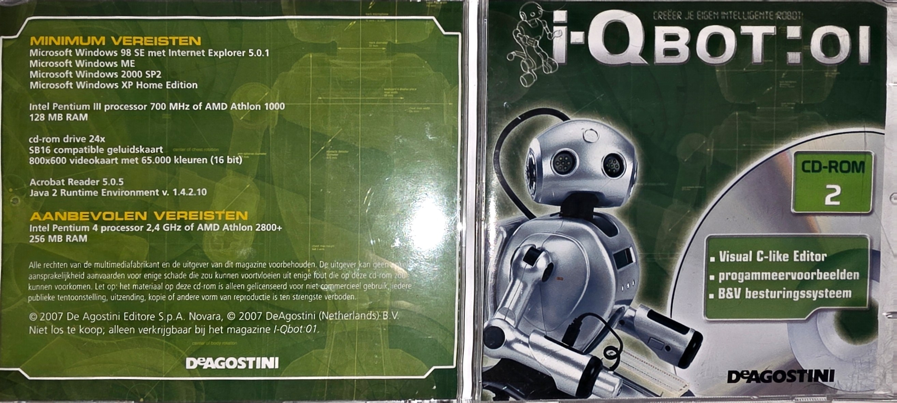 | 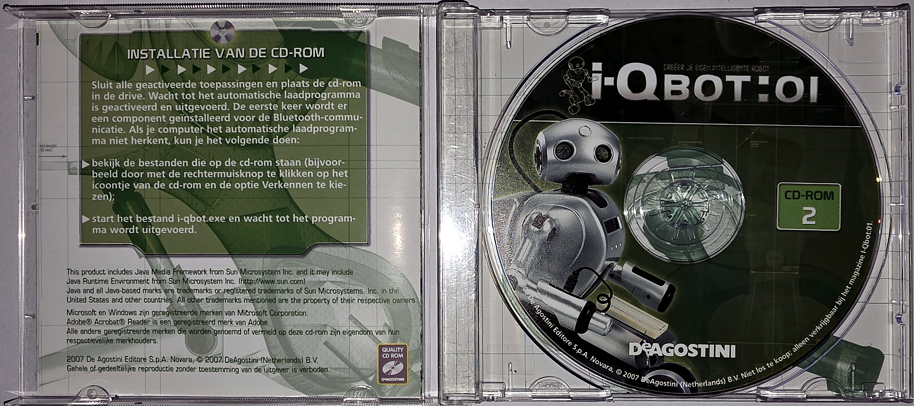 | 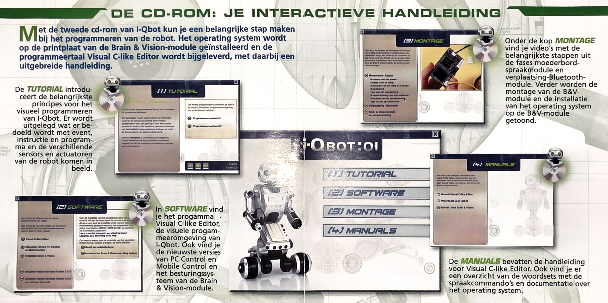 |

### CD-ROM 3

| Front and back | Inside case | Flyer |
|---|---|---|
| 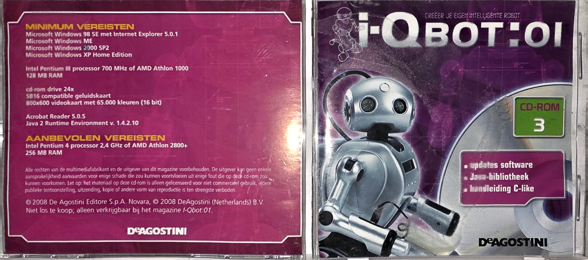 | 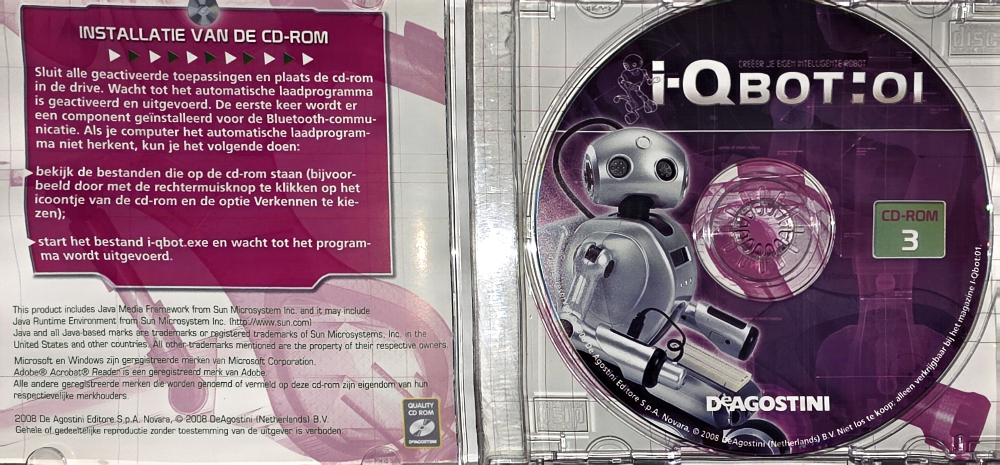 | 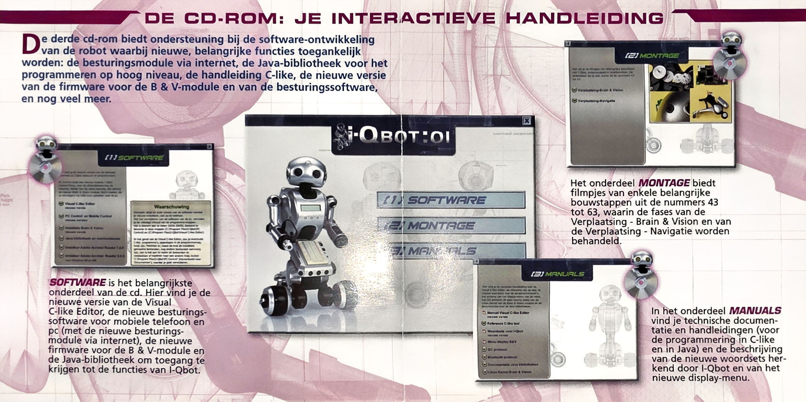 |

### CD-ROM 4

| Front and back | Inside case | Flyer |
|---|---|---|
| 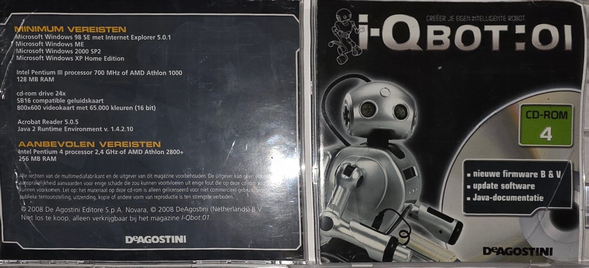 | 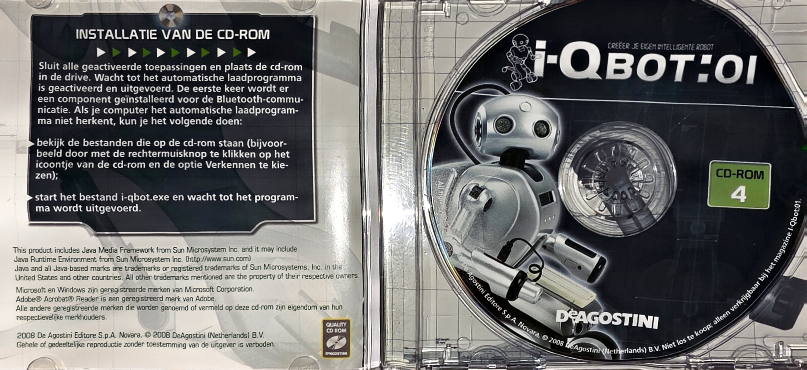 | 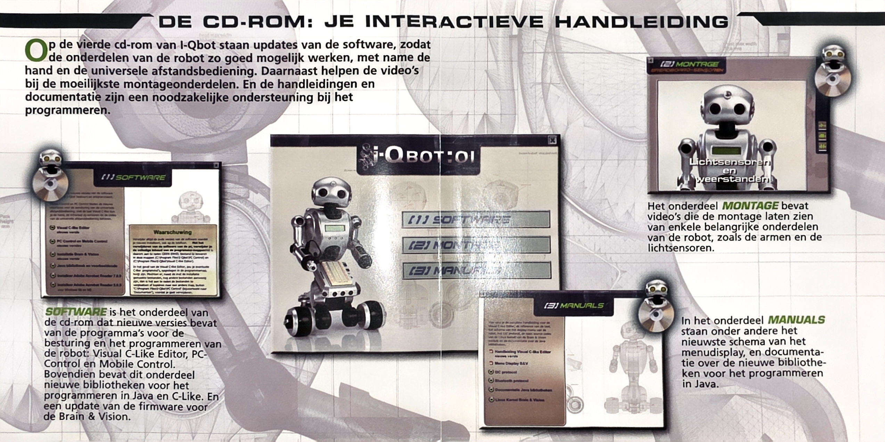 |

## Copyright

All disc content and artwork © 2007–2008 De Agostini Editore S.p.A. (Novara) and De Agostini (Netherlands) B.V. These discs were never sold separately; they came only with the *I-Qbot:01* magazine. This archive is shared for preservation, so owners of the robot can still get the software. No ownership is claimed. If you are a rights holder and want something removed, please open an issue.
